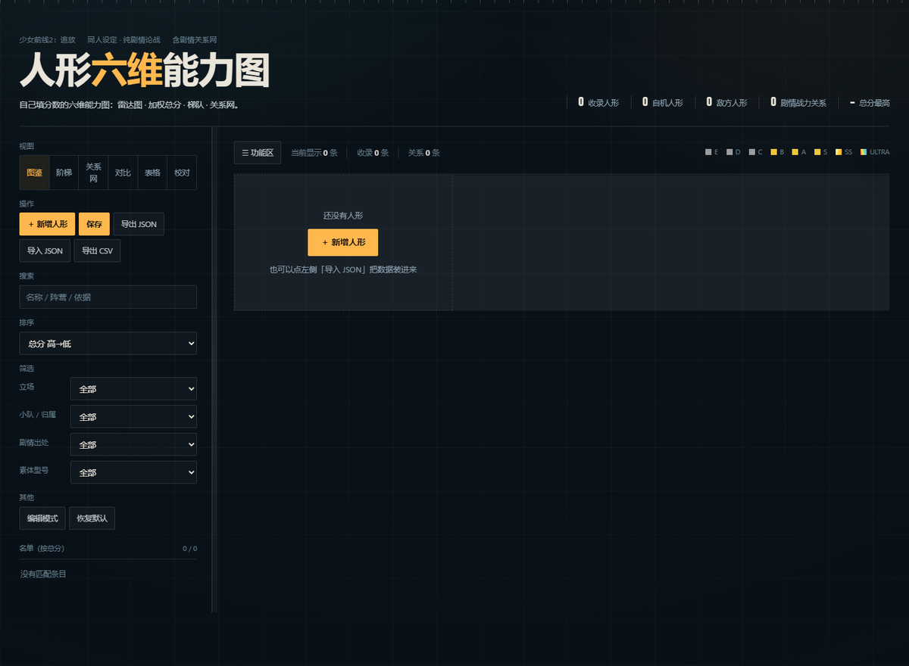

# 少前2 人形六维能力图

单文件网页工具：把角色按**六个维度**打分 → 画雷达图 → 算加权总分 → 排梯队 → 画关系网。
内置数据已清空，**打开就能自己填**。



## 打开就能用

双击 `少前2_人形六维能力图.html`（纯本地单文件，不需要服务器、不联网）。

| 操作 | 说明 |
|---|---|
| 新增人形 | 左侧最上面的「**＋ 新增人形**」；空表时页面中央也有一个大按钮 |
| 改数值 | ① 编辑弹窗拖滑条；② **直接在雷达图上拖顶点**（沿轴拖，实时重算总分与档位）；③ 表格视图直接改 |
| 保存 | 左侧「保存」按钮：改动先留在内存（按钮显示「保存 •」），点了才写进浏览器存档，并弹**「是否覆盖」**确认；有未保存改动时关页面会拦一下 |
| 导入 / 导出 | 「导出 JSON」把当前数据存成文件；「导入 JSON」装回来 |
| 双形态套图 | 同一张六维图叠两种形态：点卡片上的形态按钮切换，**切换只改对比度**（哪一态亮＝哪一态当前）；在 `formVariants` 里按同名人物配置 |
| 视图 | 图鉴 / 阶梯 / 关系网 / 对比 / 表格 / 校对；地址栏可用 `#view=table`、`#form=1` 之类直接跳 |
| 排版调参 | 打开 [`六维图_排版调参器.html`](六维图_排版调参器.html)：27 个取色器 + 20 个滑条，背景／卡片／文字／雷达线条／阵营／八个档位颜色与全部几何尺寸都能调，右侧 4 张样本卡实时预览，点「复制配置」把 JSON 发我即可落进页面（默认值＝线上当前版本） |
| 功能栏 | 左侧功能栏**可折叠**（点顶部「☰ 功能区」）、**可拖右边缘调宽**（220–620px，宽度会记住）；常用功能排最上面 |

## 六维口径（都可在数据文件里改）

| 维度 | 定义 |
|---|---|
| 火力 | 远程火力投放能力 / 单发威力 |
| 电子战 | 电子攻防 / 入侵与反入侵 |
| 搏斗 | 近身战斗能力 |
| 素体 | 素体强度 —— **型号的纯函数**（同型号同分，见 `frameBaseline`） |
| 速度 | 现沿用原「心智」口径（`dimRenameNote` 记了改名沿革），尚未按真·速度重评 |
| 战术 | 战场经验 / 战术运用 / 临战判断 |

- **字母档＝数值分带**：E <12.5 ≤ D <25 ≤ C <37.5 ≤ B <50 ≤ A <62.5 ≤ S <75 ≤ **SS ≤100** < **ULTRA**（>100 即 ULTRA，顶点 200）
- **总分＝六维加权**：搏斗 25／素体 20／火力 18／战术 15／电子战 12／速度 10；每维都有「参与总分」开关，关掉的整项剔除后按剩余权重归一
- 数据全在 `少前2_人形六维数据.json`：`entries`（人形）、`edges`（关系边，带原文）、`dimDefs`（维度定义）、`weights`、`ultraRule`（每维 ULTRA 锚）、`frameBaseline`（型号 → 素体强度）、`formVariants`（双形态）

## 改完必跑

```bash
node _work/build_doc.mjs       # 由 JSON 重生成 _work/剧情证据与评分依据.md
node _work/verify_scores.mjs   # 19 项自检：数据结构 / 页面接线 / 总分与档位 / 保存与拖动
```

页面里的内置数据（`DEFAULT_DATA` / `DEFAULT_EDGES` / `FORM_DATA`）**不会自动跟着 JSON 变**，改完 JSON 要同步进页面，自检第 02–04 项会盯着这件事。

## 历史归档

`_work/archive/2026-10-10_完整73人形/` 是清空前的完整版本：73 条人形 JSON、当时的页面、依据档、53 条作者裁定流水。想找回旧数据照那儿的 README 操作。

## 关于语料

依据档里的原文出自本机客户端文本表 `_tools/gf2_lang_cn.txt`。**出于版权考虑，语料与解包表没有放进仓库**；需要做语料检索时自己准备该文件。
